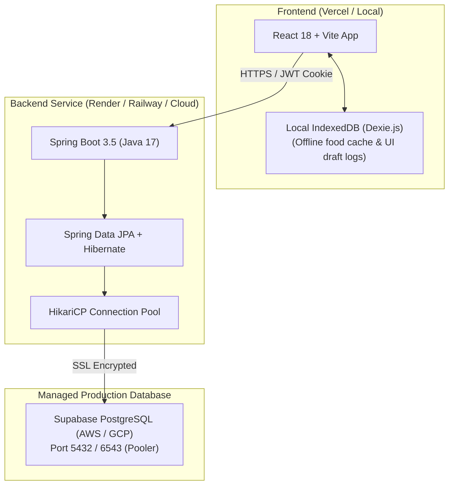

# NutReBirth — Production Database Requirements & Migration Plan

## 1. Overview & Objective

NutReBirth is currently operating on:
- **Phase 1 (Active)**: Local persistent file-based H2 database (`jdbc:h2:file:./data/nutrebirth_db`).
  - Solves the immediate issue of in-memory data loss during local development.
  - User records, Google OAuth IDs, and upgraded **PREMIUM** plan statuses persist across server reboots on disk in `./data/nutrebirth_db.mv.db`.
- **Phase 2 (Required for Production)**: Managed, serverless/cloud **PostgreSQL** instance (e.g., **Supabase** or **Neon**).
  - Required for public deployment on Render, Railway, or cloud VMs.
  - Ensures atomic transactions, multi-instance concurrency, persistent disaster recovery, and permanent user subscription storage.

---

## 2. Production Database Architecture



---

## 3. Recommended Production Provider: Supabase

### Why Supabase?
1. **Free Tier**: 500 MB cloud PostgreSQL database, which comfortably supports thousands of user accounts and payment records.
2. **Built-in Connection Pooling (Supavisor)**: Essential for serverless and auto-scaling backend environments to prevent connection exhaustion.
3. **Web Dashboard**: Direct SQL editor, table viewer, role-based access visualizer, and export tools.
4. **Permanent Storage**: Does not wipe or terminate databases automatically (unlike Render's 30-day trial database).
5. **SSL Enforcement**: Native `sslmode=require` ensures compliance with payment card and authentication standards.

*Secondary Alternative*: **Neon.tech** (0.5 GB free serverless Postgres with instant branching).

---

## 4. Database Schema Requirements

### 4.1. Core Table: `users`
| Column | Type | Constraints | Description |
|---|---|---|---|
| `id` | `UUID` | `PRIMARY KEY` | Unique identifier generated by backend |
| `email` | `VARCHAR(255)` | `NOT NULL`, `UNIQUE` | User's verified Google account email |
| `name` | `VARCHAR(255)` | `NULLABLE` | Display name from Google Profile |
| `picture_url` | `VARCHAR(1024)` | `NULLABLE` | Profile avatar URL from Google OAuth |
| `plan` | `VARCHAR(32)` | `NOT NULL`, `DEFAULT 'FREE'` | Subscription tier: `'FREE'` or `'PREMIUM'` |
| `created_at` | `TIMESTAMP WITH TIME ZONE` | `DEFAULT NOW()` | Account creation timestamp |
| `updated_at` | `TIMESTAMP WITH TIME ZONE` | `DEFAULT NOW()` | Last update timestamp |

### 4.2. Planned Future Tables (Cloud Sync Migration from IndexedDB)
- `user_profiles`: Height, weight, age, sex, activity level, macro goals, and diet type.
- `payment_orders`: Razorpay `order_id`, `payment_id`, signature, amount, currency, status (`CREATED`, `PAID`, `FAILED`).
- `meal_logs`: User daily meals synced to cloud so data is shared across multiple devices.

---

## 5. Migration Checklist for Production

### Step 1: Add PostgreSQL Driver to `service/pom.xml`
```xml
<!-- PostgreSQL Driver (for production deployment) -->
<dependency>
    <groupId>org.postgresql</groupId>
    <artifactId>postgresql</artifactId>
    <scope>runtime</scope>
</dependency>
```

### Step 2: Configure Spring Boot Profiles in `application.yml`
The application is pre-configured to accept environment variables dynamically:

```yaml
spring:
  datasource:
    url: ${SPRING_DATASOURCE_URL:jdbc:h2:file:./data/nutrebirth_db;DB_CLOSE_DELAY=-1;DB_CLOSE_ON_EXIT=FALSE}
    driverClassName: ${SPRING_DATASOURCE_DRIVER:org.h2.Driver}
    username: ${SPRING_DATASOURCE_USERNAME:sa}
    password: ${SPRING_DATASOURCE_PASSWORD:}
  jpa:
    database-platform: ${SPRING_JPA_DATABASE_PLATFORM:org.hibernate.dialect.H2Dialect}
    hibernate:
      ddl-auto: ${SPRING_JPA_HIBERNATE_DDL_AUTO:update}
```

### Step 3: Supabase Setup
1. Create a free project at [supabase.com](https://supabase.com).
2. Go to **Project Settings** → **Database** → **Connection String** → **URI**.
3. Copy the JDBC connection string (format):
   ```
   jdbc:postgresql://<host>:5432/postgres?sslmode=require
   ```

### Step 4: Environment Variables on Production Host (Render / Railway)
Set the following environment variables on your deployment platform:

```bash
SPRING_DATASOURCE_URL=jdbc:postgresql://db.<project-ref>.supabase.co:5432/postgres?sslmode=require
SPRING_DATASOURCE_DRIVER=org.postgresql.Driver
SPRING_DATASOURCE_USERNAME=postgres
SPRING_DATASOURCE_PASSWORD=<your-supabase-db-password>
SPRING_JPA_DATABASE_PLATFORM=org.hibernate.dialect.PostgreSQLDialect
SPRING_JPA_HIBERNATE_DDL_AUTO=update
```

---

## 6. Current Implementation (Local Phase 1)

For local development without network overhead or cloud setup:
- Database engine: **H2 (File mode)**
- Storage location: `./service/data/nutrebirth_db.mv.db`
- Ignored in Git: `data/` and `*.mv.db` in [service/.gitignore](file:///Users/akshaykumarsingh/code/nutreBirth/service/.gitignore).
- Behavior: Server restarts now **retain** all user records, sessions, and Razorpay upgrade statuses.
